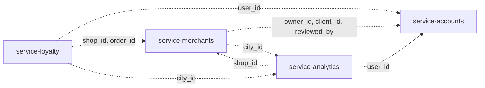
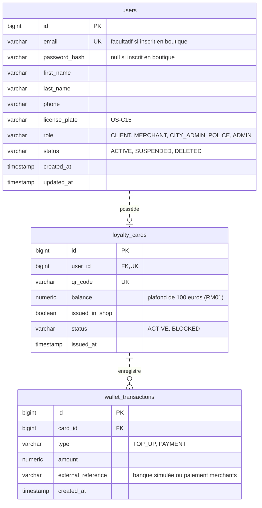
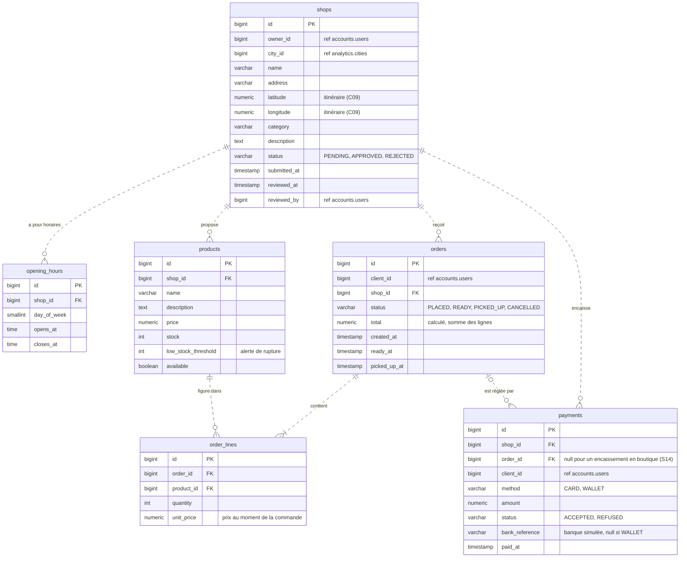
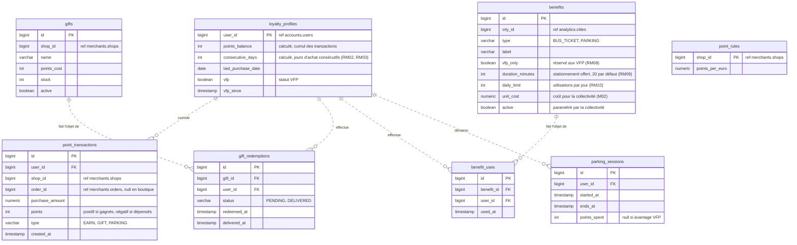
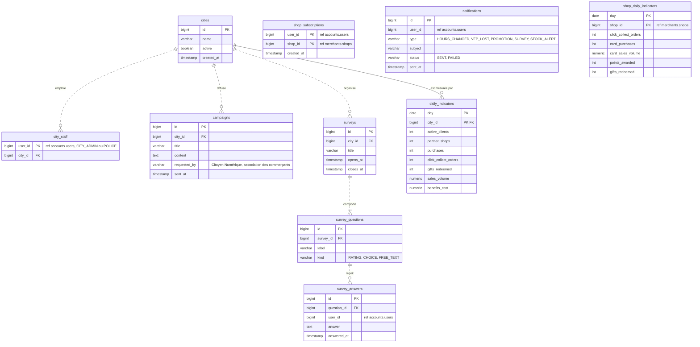

# Modèle de données

Chaque service possède sa propre base PostgreSQL. À l'intérieur d'une base, les tables sont reliées par des clés étrangères. Entre deux services, il n'y a jamais de clé étrangère : un service ne conserve que l'identifiant d'une donnée qui appartient à un autre, et la lui demande par un appel REST quand il en a besoin (R2 §1.3).

Tables déjà implémentées : `users` et `loyalty_cards` dans service-accounts, `shops` dans service-merchants (sans encore le propriétaire ni le statut de validation, qui arrivent avec US-S13 et US-A01). Les autres tables sont prévues pour les sprints suivants.

## Lire les schémas

Les schémas par service sont des modèles relationnels, en notation « patte d'oie ». À chaque extrémité d'une relation, le symbole indique combien de lignes de cette table sont concernées :

| Symbole à l'extrémité | Signification |
|---|---|
| deux traits | exactement une |
| un cercle et un trait | zéro ou une |
| une patte d'oie et un trait | une ou plusieurs |
| une patte d'oie et un cercle | zéro, une ou plusieurs |

- **Trait pointillé** : relation non identifiante. La table fille a sa propre clé primaire et référence la table mère par une clé étrangère. C'est le cas de presque toutes les relations.
- **Trait plein** : relation identifiante. La clé primaire de la table fille contient celle de la table mère (seulement `daily_indicators`).
- **PK** clé primaire, **FK** clé étrangère, **UK** valeur unique.
- **`ref service.table`** : identifiant d'une donnée qui appartient à un autre service, sans clé étrangère.
- Le texte entre guillemets précise les valeurs possibles, la règle métier ou l'US concernée. Les champs marqués « calculé » sont déduits d'autres données et conservés pour éviter de les recalculer à chaque lecture.

## Références entre services

Une flèche pointillée de X vers Y signifie que X conserve des identifiants de données appartenant à Y. Par exemple, une commande de service-merchants conserve l'identifiant du client, qui appartient à service-accounts. service-accounts ne référence aucun autre service : c'est le socle commun sur lequel les trois autres s'appuient.

## service-accounts

Comptes, cartes de fidélité et porte-monnaie. Les données personnelles, y compris la plaque d'immatriculation, ne sortent pas de cette base.

| Table | Parcours | US et règles |
|---|---|---|
| `users` | Créé à l'inscription, en ligne ou par un commerçant en boutique (sans mot de passe dans ce cas). Lu à chaque connexion ; modifié par le client (données personnelles, plaque) et par l'administrateur ShopLoc (rôle, statut). Un compte supprimé passe en `DELETED` : ses données personnelles (nom, e-mail, téléphone, plaque) sont anonymisées, mais la ligne est gardée, car d'autres services conservent son identifiant. | C01, S16, T01, T02, C15, A03 |
| `loyalty_cards` | Créée avec le compte, une seule par client. Son QR code est scanné en boutique ; son solde augmente au rechargement et baisse au paiement, sans jamais dépasser 100 €. | C01, C02, C03, C04, S08, S14, S16, RM01 |
| `wallet_transactions` | Une ligne par mouvement du porte-monnaie : rechargement auprès de la banque simulée, ou débit demandé par service-merchants lors d'un paiement. La référence externe permet de retrouver l'opération d'origine. | C03, C04, C08, S14, RM01 |

## service-merchants

Commerces, horaires, catalogue, commandes click and collect et paiements.

| Table | Parcours | US et règles |
|---|---|---|
| `shops` | Créé quand le commerçant inscrit son commerce (`PENDING`), puis validé ou refusé par l'administrateur ShopLoc. Lu par la liste des commerces et par le calcul d'itinéraire. | S13, A01, C05, C09 |
| `opening_hours` | Saisis et modifiés par le commerçant. Un changement déclenche la notification des clients qui suivent le commerce. Lus aussi pour l'itinéraire, qui tient compte des heures d'ouverture. | S10, C05, C06, C09 |
| `products` | Gérés par le commerçant. Le stock baisse à chaque commande et peut être corrigé à la main ; sous le seuil, une alerte part. | S03, S04, S15, C07 |
| `orders` | Créée quand le client valide son panier, puis passée à « prête » et « récupérée » par le commerçant. | C08, C10, S09, S01 |
| `order_lines` | Une ligne par article commandé, avec le prix au moment de la commande, qui ne change plus ensuite. | C08 |
| `payments` | Un paiement par tentative : celui d'une commande click and collect, ou un encaissement direct en boutique. Par carte bancaire, il passe par la banque simulée ; avec le solde de la carte, merchants demande d'abord le débit à service-accounts, et si ce débit échoue, le paiement est refusé. | C08, S14, RM01 |

## service-loyalty

Points, cadeaux, statut VFP et avantages de la collectivité.

| Table | Parcours | US et règles |
|---|---|---|
| `loyalty_profiles` | Créé au premier achat. Le compteur de jours consécutifs avance à chaque jour avec un achat et retombe à zéro dès qu'un jour passe sans achat. À 15 jours, le client devient VFP ; il perd ce statut au premier jour sans achat. | C04, C13, C18, RM02, RM03 |
| `point_rules` | Fixée par chaque commerçant : le nombre de points par euro dépensé. Deux commerces peuvent donc donner un nombre de points différent pour le même achat. | S11, RM04, RM05 |
| `point_transactions` | Une ligne par achat payé, en boutique (carte scannée) ou en click and collect, avec les points gagnés ; une ligne négative quand des points sont dépensés. Sert aussi à vérifier l'achat antérieur exigé pour obtenir un cadeau. | C02, C04, C11, C12, S07, S08, RM04, RM06 |
| `gifts` | Catalogue de chaque commerçant, avec le coût en points. | S05, C11 |
| `gift_redemptions` | Créée quand le client échange ses points, puis validée par le commerçant au moment de la remise, carte présentée. | C11, S12, RM06, RM07 |
| `benefits` | Paramétrés par la collectivité pour sa ville : type, durée de stationnement, limite quotidienne, coût, réservés ou non aux VFP. | M08, C14, M02, RM08, RM09, RM10 |
| `benefit_uses` | Une ligne à chaque utilisation d'un avantage. Permet de limiter le transport à un trajet par jour, et de calculer ce que coûtent les avantages à la collectivité. | C14, M02, RM10 |
| `parking_sessions` | Démarrée par le client quand il se gare. Le policier saisit une plaque : loyalty demande à service-accounts à qui elle appartient, puis vérifie qu'une session est en cours. | C12, C16, P01, RM09 |

## service-analytics

Villes et leur personnel, notifications, campagnes, sondages et indicateurs agrégés.

| Table | Parcours | US et règles |
|---|---|---|
| `cities` | Créée par l'administrateur ShopLoc pour déployer la solution dans une nouvelle ville. Les commerces, les avantages et les campagnes y sont rattachés. | A02 |
| `city_staff` | Rattache chaque membre de la collectivité (rôles `CITY_ADMIN` et `POLICE` dans service-accounts) à sa ville, lors du paramétrage de la ville. Sert à limiter chacun aux données de sa ville. | A02, A03, M01 à M08, P01 |
| `shop_subscriptions` | Le client suit un commerce, et il est notifié quand ses horaires changent. | C06 |
| `notifications` | Une ligne par message envoyé : changement d'horaires, perte du statut VFP, offre promotionnelle, sondage, alerte de rupture de stock. | C06, C13, M04, M05, S04 |
| `campaigns` | Offres promotionnelles envoyées par la collectivité, à la demande du service Citoyen Numérique ou de l'association des commerçants. | M05, C17 |
| `surveys`, `survey_questions`, `survey_answers` | Un sondage lancé par la collectivité, ses questions, et les réponses des usagers. | M06, C17 |
| `daily_indicators` | Calculés chaque nuit pour chaque ville, en interrogeant les autres services. Ils alimentent les tableaux de bord et les rapports exportés de la collectivité. Le même traitement repère les clients qui ont perdu leur statut VFP et déclenche leur relance. | M01, M02, M03, M04, M07 |
| `shop_daily_indicators` | Le même calcul, pour chaque commerce. Ils alimentent le tableau de bord du commerçant et la comparaison avec les autres partenaires. | S01, S02, S06, S07 |